<div align="center">
  
</div>

# Catálogo firmado de plataformas · NEZU Arca

> **In English.** The signed public catalog of platform icons used by NEZU Arca, a local credential vault for Windows. Anyone can verify the Ed25519 signature and the SHA-256 fingerprints with the included tool and the public key published here.

[NEZU Arca](https://apps.microsoft.com/detail/9N607VDQQ6B2) es la bóveda local de credenciales de NEZU. Para mostrar cada cuenta con el icono de su plataforma (bancos, redes sociales, servicios) sin incorporar imágenes al instalador, Arca descarga un **catálogo público firmado** desde este repositorio y verifica cada icono antes de guardarlo en caché.

Aquí no hay código de la aplicación ni datos de usuarios: solo el catálogo, los iconos y las herramientas para mantenerlos.

## Cómo funciona

| Archivo | Papel |
|---|---|
| `assets/catalog.json` | Lista de plataformas disponibles con la huella SHA‑256 de cada icono y un `catalog_version` que crece con cada publicación. |
| `assets/catalog.json.sig` | Firma **Ed25519** del catálogo, producida con la clave de release de NEZU. |
| `assets/platforms/` | Los iconos. Son independientes del ejecutable de Arca. |
| `assets/SOURCES.md` | Origen oficial de cada imagen. |

Arca acepta un catálogo solo si la firma es válida con la clave pública que lleva incorporada. Después comprueba la huella de cada icono antes de usarlo. Un catálogo sin firma, o con una huella que no coincide, se descarta en silencio y la aplicación sigue con la versión anterior.

## Publicar una plataforma nueva

Desde PowerShell, con el repositorio limpio:

```powershell
.\tools\add-platform.ps1
```

Pide el nombre de la plataforma y la ruta del icono, calcula la huella SHA‑256, incrementa `catalog_version`, copia la imagen y confirma y sube el cambio. También acepta los dos valores directamente:

```powershell
.\tools\add-platform.ps1 -Name "Discord" -IconPath "C:\Imagenes\discord.png"
```

## Reemplazar iconos existentes

El ayudante en Python reemplaza uno o varios iconos en una sola revisión del catálogo. Valida cada plataforma y cada archivo antes de escribir, recalcula las huellas e incrementa `catalog_version` una sola vez:

```powershell
python .\tools\add_platform.py `
  --replace "Banco Guayaquil=C:\Imagenes\banco-guayaquil.png" `
  --replace "VIGI=C:\Imagenes\vigi.png"
```

Conserva la extensión original del archivo y anota la fuente en `assets/SOURCES.md`. Nunca edites las huellas a mano.

## Verificar el catálogo

Cualquiera puede comprobar que el catálogo publicado es el que firmó NEZU y que ningún icono fue alterado, con la misma clave pública que Arca lleva incorporada:

```text
170e1e42525574a7cc3e0cf25af429f0c797978936de5fd22a12e3d80424f921
```

```bash
pip install cryptography
python tools/verify_catalog.py            # el catálogo de este checkout
python tools/verify_catalog.py --remote   # el publicado en GitHub, tal como lo descarga Arca
```

La herramienta valida la firma Ed25519 sobre la forma canónica del catálogo y después la huella SHA‑256 de cada icono. Termina con código `0` si todo coincide y `1`, con el detalle, si algo falla. Solo NEZU tiene la clave privada; la pública se puede redistribuir sin riesgo.

## Firmar el catálogo

La firma se genera en local con la clave de release, que vive únicamente en la variable de entorno `NEZU_RELEASE_PRIVATE_KEY_HEX` del equipo autorizado. Nunca en un archivo, un commit ni un registro.

```powershell
python .\tools\sign_catalog.py --catalog assets\catalog.json --signature assets\catalog.json.sig
```

Confirma `catalog.json.sig` junto con el catálogo que firma. Si el catálogo se publicó antes que su firma, Arca lo rechaza hasta que la firma llegue: es el comportamiento esperado.

> Hasta noviembre de 2026 la firma la producía un flujo de GitHub Actions. Ese flujo se retiró; la firma es ahora un paso local.

## Estructura

```text
assets/
  catalog.json          catálogo publicado
  catalog.json.sig      firma Ed25519 del catálogo
  platforms/            iconos por plataforma
  SOURCES.md            origen oficial de cada icono
tools/
  add-platform.ps1      alta de plataforma con commit y push
  add_platform.py       reemplazo de iconos en una sola revisión
  sign_catalog.py       firma del catálogo con la clave de release
  verify_catalog.py     verificación pública de firma y huellas
tests/                  pruebas de las herramientas
```

## Reglas

- Varias plataformas en un solo commit cuando sea posible: una sola firma y una sola versión.
- Sin duplicados ni rutas fuera de `assets/platforms/`.
- Material gráfico solo de fuentes oficiales, registrado en `SOURCES.md`.
- No declarar un catálogo disponible hasta que la firma esté publicada y validada.

## ¿Quieres NEZU Arca?

Arca está en [Microsoft Store](https://apps.microsoft.com/detail/9N607VDQQ6B2) para Windows. Si necesitas Arca en varias estaciones de tu empresa, o una bóveda local adaptada a tu operación, [cuéntanos qué necesitas](https://nezuecuador.com/es/contacto) y te respondemos con una propuesta concreta.

## Licencia

Licencia NEZU de uso para clientes e integradores: puedes leer, instalar y operar el código y proponer mejoras; no puedes redistribuirlo, venderlo ni usarlo para construir un producto o servicio competidor. Texto completo en [LICENSE.md](LICENSE.md).

---

<div align="center">
  <sub>Parte del ecosistema <a href="https://github.com/NezuSas">NEZU</a> · <a href="https://nezuecuador.com">nezuecuador.com</a> · © NEZU S.A.S. Publicado para los usuarios de NEZU Arca.</sub>
</div>
